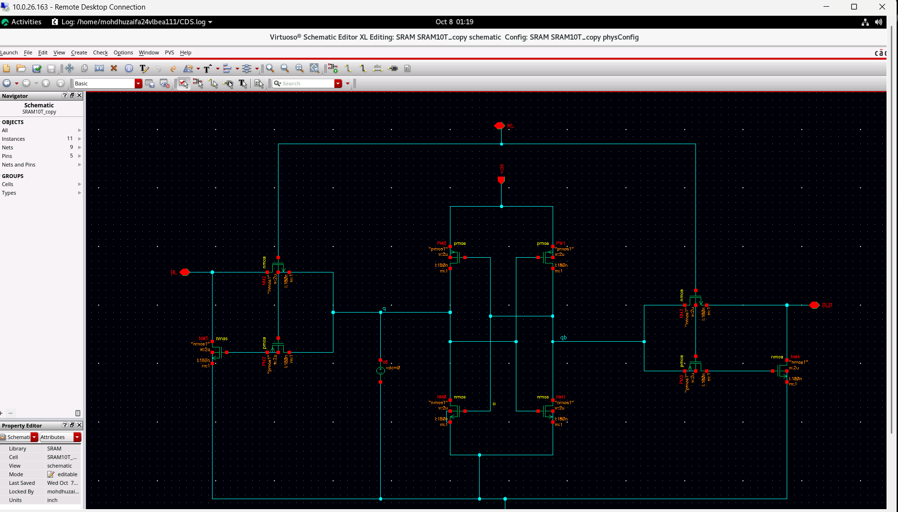
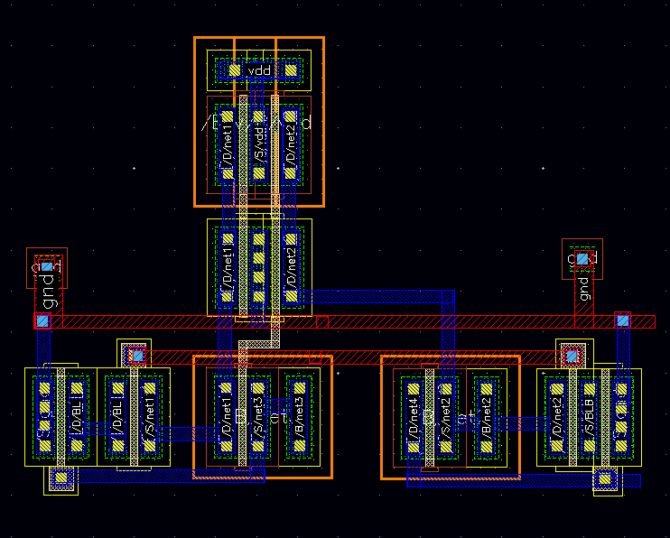

# 10T SRAM Design Using Cadence Virtuoso

Design and DC analysis of a 10-transistor SRAM cell using Cadence Virtuoso.

## Project Overview

This project focuses on the transistor-level schematic design, DC analysis, and layout of a 10T SRAM cell using Cadence Virtuoso.

This project was completed under the guidance of Prof. Mohd Wajid.

## Tools Used

- Cadence Virtuoso
- CMOS Circuit Design
- DC Analysis

## Design and Simulation

### 1. SRAM Schematic

### 2. DC Analysis

### 3. Layout

## Project Demonstration

Watch the complete 10T SRAM design and simulation walkthrough using Cadence Virtuoso.

**YouTube Video:** [Watch the Project Demonstration](https://youtu.be/LU7Sb7IUooM)

## Learning Outcomes

- Transistor-level CMOS circuit design
- SRAM schematic development and layout design
- DC simulation and analysis
- Practical experience with Cadence Virtuoso EDA tools

## Author

**Mohd Huzaifa**  
B.Tech Electronics (VLSI)  
Zakir Husain College of Engineering and Technology  
Aligarh Muslim University  

**Guided by:**  
Prof. Mohd Wajid  
Department of Electronics Engineering  
Zakir Husain College of Engineering and Technology, AMU
